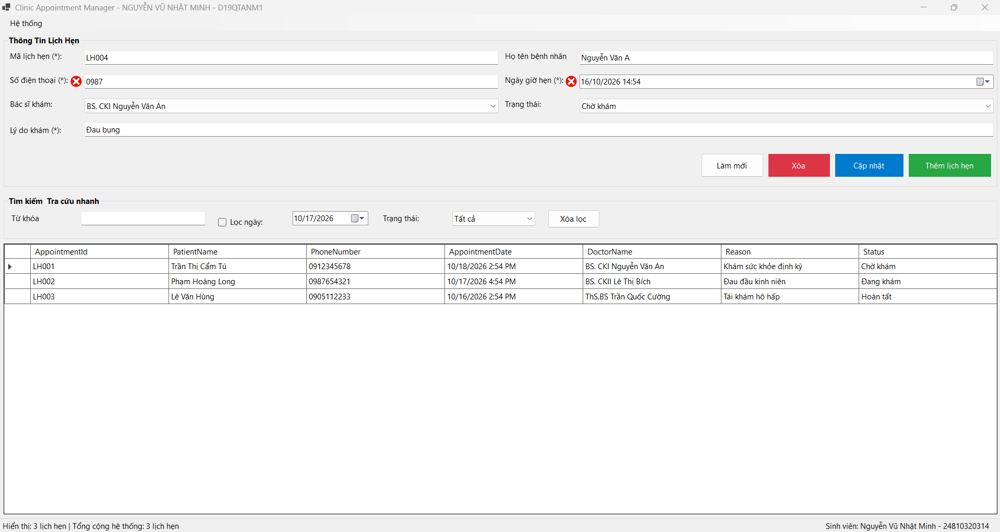
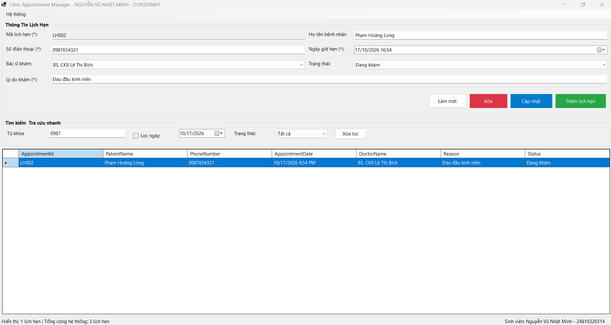
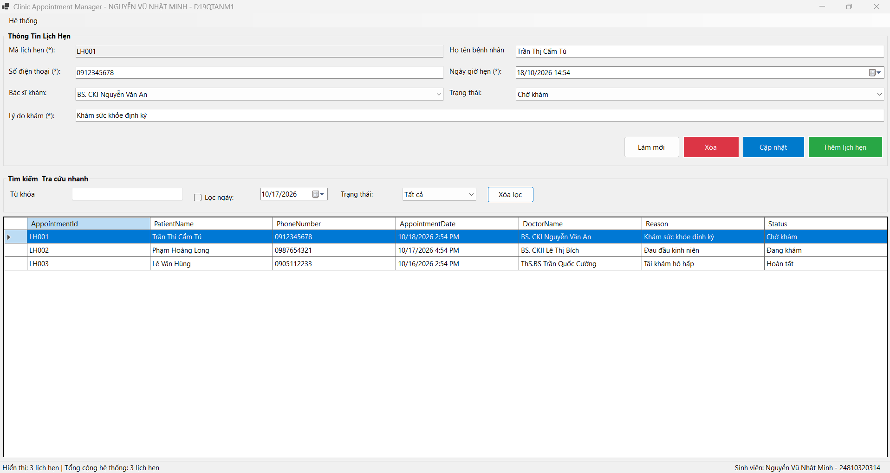
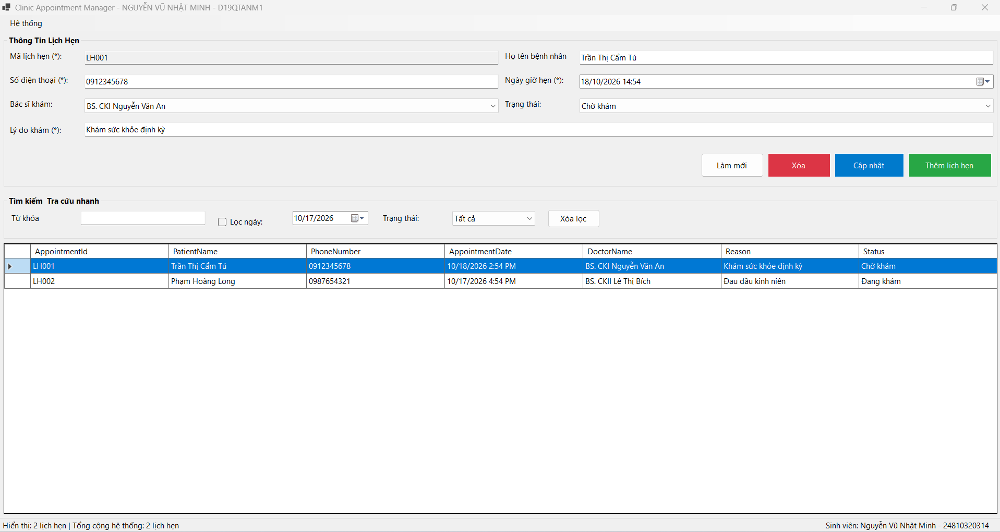

# BÁO CÁO BÀI TẬP / ĐỒ ÁN

## THÔNG TIN SINH VIÊN
- **Họ và tên:** Nguyễn Vũ Nhật Minh
- **Mã số sinh viên:** 24810320314
- **Lớp:** D19QTANM1
- **Tên môn học:** Lập trình C# / Windows Forms
- **Tên bài tập:** BÀI 4.9: Quản lý lịch hẹn phòng khám (Clinic Appointment Manager)

---

## KẾT QUẢ THỰC HÀNH & KIỂM THỬ

### 1. Không cho lưu lịch hẹn có số điện thoại sai hoặc ngày trong quá khứ

### 2. Tìm kiếm theo số điện thoại trả về đúng lịch

### 3. Trạng thái và số lượng trên bảng/trạng thái cập nhật trước khi sửa, xóa và lọc.

### 4. Trạng thái và số lượng trên bảng/trạng thái cập nhật sau khi sửa, xóa và lọc.

---